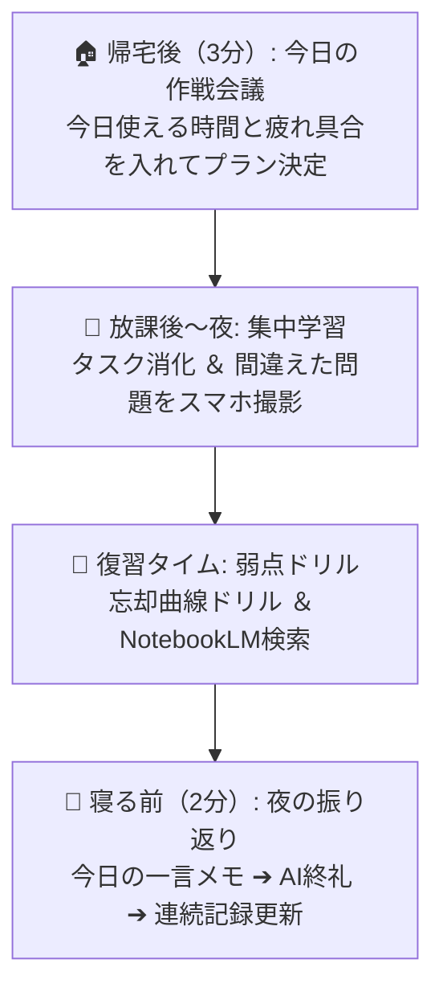

# 🎓 AI学習パートナー 活用ガイド
### 〜 松江北高校 理数科から医学部医学科 現役合格へ 〜

こんにちは！このアプリは、松江北高校理数科でのハイレベルな授業・Focus Gold先取り学習をサポートし、**国公立大学 医学部医学科の現役合格**を本気で掴み取るために作られた、あなた専用の自走型AI伴走パートナーです。

毎日の勉強をゲームのようにEXP（経験値）を貯めながら進め、間違えた問題を確実に「一生モノの得点源」に変えていきましょう！

---

## 📱 STEP 0: まずスマホのホーム画面にアプリアイコンを追加しよう（1分）

ブラウザで毎回開くのではなく、スマホのホーム画面にアプリとして登録するのがおすすめです。

* **専用URL**: [https://matsuekita-med-partner.streamlit.app](https://matsuekita-med-partner.streamlit.app)

### 【iPhone の場合】
1. Safari で上記URLを開きます。
2. 画面下部の中央にある **「共有」ボタン（四角から上向き矢印が出ているアイコン）** をタップします。
3. 下にスクロールして **「ホーム画面に追加」** をタップします。
4. ホーム画面にアイコンが作成され、タップするだけで全画面起動します！

### 【Android の場合】
1. Chrome で上記URLを開きます。
2. 画面右上の **「︙（3点リーダー）」** をタップします。
3. **「ホーム画面に追加」**（または「アプリをインストール」）をタップします。

---

## 📅 1日の黄金ルーティン（使い方の流れ）

このアプリは、**「帰宅後の作戦 ➔ 夜の集中学習 ➔ 就寝前の振り返り」** という、あなたの自然な生活リズムに合わせて無理なく進められる設計になっています（※朝に無理して開く必要は一切ありません！）。

---

### 1. 🏠 学校から帰ってきたら（所要時間: 3分）
👉 **【タブ1: 🎯 今日の作戦会議】を開く**

学校から帰って手洗いうがいをしたら、お茶でも飲みながらスマホでサッと開いてみましょう。

1. **「帰宅後の目標学習時間」** をスライダーで設定します（例: 平日は宿題やFocus Goldで2.5〜4時間、休日は6〜8時間など）。
2. 今日の疲れ具合（「学校帰り・疲労気味 🥱」「ひと息ついてリセット ☕」「集中モード ⚡」など）を選びます。
3. AIが自動で今日の疲労度に合わせて科目配分と予想EXPを計算し、3つのプランを提案してくれます：
   * **プランA（王道バランス）**: 数学・英語・化学をバランスよく前進
   * **プランB（数・理 突破）**: 宿題＋Focus Gold難問・物理を集中的に攻略
   * **プランC（弱点総ざらい）**: 今日は疲れているから、復習ドリルとメンテナンス中心
4. 気に入ったプランを選んで **「🚀 このプランで確定する」** を押すと、今日のやることリストが自動でセットされます！

---

### 2. 📖 勉強中・間違えた問題に出会ったら
👉 **【タブ3: 🔄 弱点克服＆復習ドリル】を活用する**

医学部受験で合否を分けるのは、「初見で解けた問題」ではなく**「間違えた問題を二度と間違えないようにしたかどうか」**です。

#### 📸 ① スマホカメラで撮って即時登録
* Focus Goldや松江北高のプリントで間違えたら、その場ですぐに写真をパシャリ！
* **Gemini 3.6 Flash** が数式や手書き答案を瞬時に読み取り、「どこで間違えたのか（誤答原因）」と「解法の着眼点ヒント」を自動で整理して弱点リストに登録してくれます。

#### 🧠 ② エビングハウス忘却曲線ドリル
* 人間の脳は数日で忘れるようにできています。アプリが「今日復習すべき問題」を自動でお知らせしてくれます。
* 解き直したあと、自己評価ボタンを押します：
  * **🟢 完璧！自力クリア**（+120 EXP / 次回复習は7日後や14日後へ自動延長）
  * **🟡 ギリギリ/ヒント見た**（+60 EXP / 間隔を維持してもう一度定着）
  * **🔴 解けなかった**（明日もう一度自動で再出題）

#### 📚 ③ NotebookLM で教科書・Focus Goldの解説を引く
* 「📖 NotebookLM で解説を検索」ボタンを押すと、お父様が設定してくれた解説ノートが開き、該当単元の詳しい解法や公式を瞬時に確認できます。

#### 🧮 ④ Python自己検算ツール
* 2次関数の最大最小や、化学のモル計算で「手計算の答えが合っているか不安…」なときは、数値を入力するとその場でグラフ描画＆厳密検算ができます。

#### 🖨️ ⑤ 週末のA4弱点テスト印刷
* 週末には、たまった弱点問題から **「週末弱点テスト」** を自動作成できます。
* 「ブラウザ印刷 (Cmd+P)」を押して紙に印刷し、制限時間を測って本番形式で解き直しましょう！

---

### 3. 🌙 夜寝る前に（所要時間: 2分）
👉 **【タブ2: 🏠 本日のダッシュボード】を開く**

1. 終わったタスクにチェックを入れていきます（EXPがグングン貯まります！）。
2. 下にある **「🌙 夜の振り返り（Daily Check-out）」** に進みます。
3. 「今日気づいたこと」「明日やりたいこと」を1〜2行メモします（例: *「Focus Gold例題65の場合分け、軸の図を描いたら納得できた！」* など）。
4. **「🎉 本日の学習を完了してAI終礼メッセージをもらう」** をタップ！
5. ソクラテス先生から温かい労いと明日へのアドバイスが届き、**連続学習記録（ストリーク）が +1日更新** されます 🔥

---

### 4. 💬 疑問が湧いたらいつでも
👉 **【タブ5: 💬 24時間質問部屋】**

* 「なぜこの公式を使うの？」「この場合分けの意味がわからない」など、疑問があればいつでも質問してください。
* このAIは**安易に答えを教えません**。「定義は何だった？」「グラフの軸はどこにあるかな？」と問いかけて、**あなた自身が自力でひらめく瞬間**をアシストしてくれます。

---

### 5. 📈 週末や模試の後
👉 **【タブ4: 📈 全体ロードマップ】**

* **模試・定期テスト成績管理**: 模試が返ってきたら偏差値を記録。国公立医学部の合格ボーダー（**偏差値 68.0**）とのギャップをいつでも可視化できます。
* **Focus Gold＆理科 単元別マスター進捗**: 数学I・A、先取り数学II・B、物理基礎、化学基礎の全単元リストです。Focus Goldの類題まで解けるようになったら「Focus Goldマスター 🎓」に切り替えていきましょう！

---

## 🌟 困ったときの Q&A

* **Q. メニュー（サイドバー）を開きたい・閉じたい**
  * 画面左上の **「＞」** をタップすると設定メニューが開き、右上の **「≪」** または暗い背景をタップすると閉じます。
* **Q. データは消えない？**
  * タスクのチェックや日々の記録はすべて安全に自動保存されています。安心して毎日使ってください！
* **Q. APIキーって何？入力が必要？**
  * お父様がすでに裏側に自動設定してくれているので、**あなたは何もしなくてOK**です！開いた瞬間からAIがフル稼働します。

---

松江北高校 理数科での毎日は課題も多く大変ですが、**「弱点をその場で潰し、忘却曲線で定着させる」** ことを続ければ、医学部医学科の現役合格は確実に射程圏内に入ります。

今日から一緒に、一歩ずつ進めていきましょう！応援しています 🚀✨
