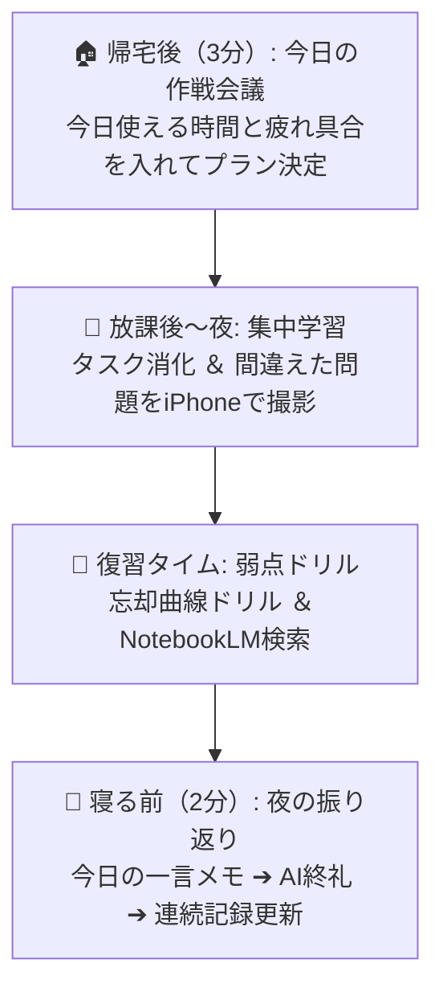

# 🎓 AI学習パートナー 活用ガイド
### 〜 松江北高校 理数科から国公立大学医学部医学科 現役合格へ 〜

こんにちは！このアプリは、松江北高校 理数科でのハイレベルな授業・Focus Gold先取り学習を完全サポートし、**国公立大学 医学部医学科の現役合格**を本気で掴み取るために作られた、あなた専用の自走型AI伴走パートナーです。

毎日の勉強をゲームのようにEXP（経験値）を貯めながら進め、間違えた問題を確実に「一生モノの得点源」に変えていきましょう！

---

## 📱💻 STEP 0: あなたのデバイスでの準備（1分）

あなたの **iPhone 16e** と **HP 15インチ ノートPC** の両方から、いつでも同じデータにアクセスできます。

* **アプリ専用URL**: [https://matsuekita-med-partner.streamlit.app](https://matsuekita-med-partner.streamlit.app)

### 📱 【iPhone 16e】ホーム画面にアプリ化しよう
スマホのホーム画面にアプリアイコンを置いておくと、タップするだけで全画面起動します。
1. **Safari** で上記URLを開きます。
2. 画面下部の中央にある **「共有」ボタン（四角から上向き矢印が出ているアイコン）** をタップします。
3. 下にスクロールして **「ホーム画面に追加」** をタップします。
4. これでホーム画面にアイコンが作成されます！

### 💻 【HP 15インチ ノートPC】ブラウザでブックマークしよう
机でじっくり勉強するときは大画面のノートPCがとても見やすくて便利です。
1. **Google Chrome** または **Microsoft Edge** で上記URLを開きます。
2. アドレスバー右側の **「☆（お気に入り / ブックマークに追加）」** をクリックして保存します。
3. （※必要なら、URLのアイコンをデスクトップにドラッグ＆ドロップすると、デスクトップ上にショートカットアイコンが作れます）

---

## 💡 iPhone 16e と HPノートPC のおすすめ使い分け術

| 場面 | 使うデバイス | 主な活用方法 |
|---|---|---|
| **学校からの帰宅直後** | 📱 **iPhone 16e** | ソファでお茶を飲みながら、**【作戦会議】** で今日使える時間をポチッと設定 |
| **勉強中（机での演習）** | 💻 **HP ノートPC** | 15インチの大画面で **【タスク一覧】** や **【単元別マスターマップ】** を見ながらFocus Gold演習 |
| **問題を間違えた瞬間** | 📱 **iPhone 16e** | カメラでノートや問題集を **パシャリと撮影 📸**（Geminiが瞬時に弱点登録） |
| **数式検算・疑問相談** | 💻 **HP ノートPC** | キーボードで **【質問部屋】** に質問入力 ＆ **【Python検算】** で2次関数グラフを検証 |
| **週末のテスト演習** | 💻 **HP ノートPC** | **【週末弱点テスト】** を画面で確認し、プリンターで紙に印刷して本番演習 |
| **夜寝る前（布団に入る前）** | 📱 **iPhone 16e** | **【夜の振り返り】** に今日の一言を入れてAI終礼をもらい、ストリーク+1日 🔥 |

---

## 📅 松江北高校（高1）公式スケジュール連動中！

アプリ内の **【タブ4: 📈 全体ロードマップ】** には、松江北高の年間行事予定表がセットされています。いつでも「あと何日か」を自動カウントダウンしてくれます。

* **🔥 2学期 期末試験**: **11月25日(水) 〜 12月1日(火)**  
  ※**部活動休止は 11月18日(水) からスタート！**
* **3学期 課題テスト（数・英）**: **1月8日(金)**（始業式と同日）
* **1月 進研学力テスト（高1）**: **1月13日(水)**
* **校内実力テスト ＆ 駿台全国模試**: **1月29日(金)・30日(土)**
* **学年末試験**: **2月18日(木) 〜 2月24日(水)**（部活休止: 2/12〜）

---

## ☕ 放課後の黄金ルーティン（使い方の流れ）

このアプリは、**「学校から帰宅 ➔ 夜の集中学習 ➔ 就寝前の振り返り」** という生活リズムに寄り添った設計になっています。  
※**朝に無理して開く必要は一切ありません！** 学校から帰ってひと息ついたタイミングで使ってください。

---

### 1. 🏠 学校から帰ってきたら（所要時間: 3分）
👉 **【タブ1: 🎯 今日の作戦会議】を開く**

手洗いうがいをして、お茶やお菓子でひと息ついたら iPhone 16e で開きましょう。

1. **「帰宅後の目標学習時間」** をスライダーで設定します：
   * 平日（部活休止期間・期末前）: `3.0 〜 4.5 時間`
   * 休日（土日）: `6.0 〜 8.0 時間`
2. 今日の疲れ具合（`学校帰り・疲労気味 🥱` / `ひと息ついてリセット ☕` / `集中モード突入 ⚡`）を選びます。
3. AIが今日のコンディションに合わせて科目配分と予想獲得EXPを自動計算し、3つのプランを提案してくれます：
   * **プランA（王道バランス）**: 数学・英語・化学をバランスよく前進
   * **プランB（数・理 突破）**: 宿題＋Focus Gold難問・物理を集中的に攻略
   * **プランC（弱点総ざらい）**: 今日は疲れているから、忘却曲線ドリルと間違えた問題の解き直し中心
4. 気に入ったプランを選んで **「🚀 このプランで本日のスケジュールを確定する」** をタップ！  
   ➔ 今日のやることリストが自動でセットされます。

---

### 2. 📖 勉強中・間違えた問題に出会ったら
👉 **【タブ3: 🔄 弱点克服＆復習ドリル】を活用する**

医学部現役合格の最大の秘訣は、「解けた問題」ではなく**「間違えた問題を二度と間違えないようにしたかどうか」**です。

#### 📸 ① iPhone 16e のカメラで撮って即時登録
* Focus Gold、定期テスト過去問、松江北高プリントで間違えたら、その場ですぐiPhoneで写真をパシャリ！
* **Gemini 3.6 Flash** が数式や手書き答案を瞬時に読み取り、**「どこで間違えたか（誤答原因）」** と **「ソクラテス的着眼点ヒント」** を自動抽出して弱点リストに登録してくれます。

#### 🧠 ② エビングハウス忘却曲線ドリル
* 人間の脳は数日で忘れるようにできています。アプリが「今日復習すべき問題」を自動でお知らせしてくれます。
* 解き直したあと、自己評価ボタンを押します：
  * **🟢 完璧！自力クリア**（+120 EXP / 次回復習は7日後や14日後へ自動延長）
  * **🟡 ギリギリ/ヒント見た**（+60 EXP / 間隔を維持してもう一度定着）
  * **🔴 解けなかった**（明日もう一度自動で再出題）

#### 📚 ③ NotebookLM で教科書・Focus Goldの解説を引く
* 「📖 NotebookLM で解説を検索」ボタンを押すと、お父様が設定してくれた解説ノートが開き、該当単元の詳しい解法や公式を瞬時に確認できます。

#### 🧮 ④ Python自己検算ツール（PCの大画面だと見やすい！）
* 2次関数の最大最小や、化学のモル計算で「手計算の答えが合っているか不安…」なときは、数値を入力するとその場でグラフ描画＆厳密検算ができます。

#### 🖨️ ⑤ 週末のA4弱点総復習テスト印刷
* 週末には、HPノートPCからたまった弱点問題の **「週末弱点テスト」** を開きます。
* 「🖨️ ブラウザ印刷 (Ctrl+P)」を押して紙に印刷し、制限時間を測って本番の記述形式で解き直しましょう！

---

### 3. 🌙 夜寝る前に（所要時間: 2分）
👉 **【タブ2: 🏠 本日のダッシュボード】を開く**

1. 終わったタスクにチェックを入れていきます（EXPメーターがグングン貯まります！）。
2. ページ下部にある **「🌙 夜の振り返り（Daily Check-out）」** に進みます。
3. 「今日気づいたこと」「明日やりたいこと」を1〜2行メモします（例: *「Focus Gold例題65の2次関数の場合分けは軸の図を描くことで納得できた。明日は化学のモル濃度から始める」* など）。
4. **「🎉 本日の学習を完了してAI終礼メッセージをもらう」** をタップ！
5. ソクラテス先生から温かい労いと明日へのアドバイスが届き、**連続学習記録（ストリーク）が +1日更新** されます 🔥

---

### 4. 💬 疑問が湧いたらいつでも
👉 **【タブ5: 💬 24時間質問部屋】**

* 「なぜこの公式を使うの？」「この場合分けの境界等号の意味が感覚的にわからない」など、疑問があればいつでも質問してください。
* このAIは**安易に答えを教えません**。「定義は何だった？」「頂点から遠い方の端点はどちらかな？」と問いかけて、**あなた自身が自力でひらめく瞬間**をアシストしてくれます。

---

### 5. 📈 週末やテスト前
👉 **【タブ4: 📈 全体ロードマップ】**

* **模試・定期テスト成績管理**: テストが返ってきたら偏差値を記録。国公立医学部の合格ボーダー（**偏差値 68.0 / 校内トップ5**）に対する現在地と各教科のギャップをいつでも可視化できます。
* **Focus Gold＆理科 単元別マスター進捗**: 数学I・A、先取り数学II・B、物理基礎、化学基礎の全単元リストです。Focus Goldの類題まで解けるようになったら「Focus Goldマスター 🎓」に切り替えていきましょう！

---

## 🌟 困ったときの Q&A

* **Q. iPhone 16e でメニュー（サイドバー）を開きたい・閉じたい**
  * 画面左上の **「＞」** をタップすると設定メニューが開き、右上の **「≪」** または暗い背景をタップすると閉じます。
* **Q. データは消えない？スマホとPCで連動する？**
  * 入力した記録やチェックはすべて安全に自動保存されます。スマホで記録した内容も、PCで開けばそのまま反映されています！
* **Q. APIキーって何？入力が必要？**
  * お父様がすでに裏側に自動設定してくれているので、**あなたは何もしなくてOK**です！開いた瞬間からAIがフル稼働します。

---

松江北高校 理数科での毎日は課題も多く大変ですが、**「弱点をその場で潰し、忘却曲線で定着させる」** ことを続ければ、医学部医学科の現役合格は確実に射程圏内に入ります。

まずは **11月25日からの2学期期末試験** に向けて、今日から一緒に一歩ずつ進めていきましょう！応援しています 🚀✨
