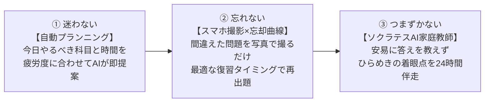
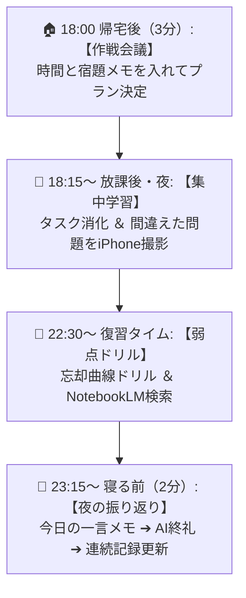
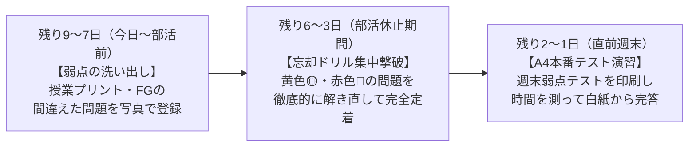

# 🎓 AI学習パートナー 完全活用バイブル
### 〜 松江北高校 理数科から国公立大学医学部医学科 現役合格へ 〜

こんにちは！このアプリは、松江北高校 理数科での日々の授業・課題・Focus Gold先取り学習を完全サポートし、**国公立大学 医学部医学科の現役合格**を掴み取るために作られた、あなた専用の自走型AI伴走パートナーです。

---

# 【第1部: 🔰 はじめての基本編 〜アプリの全体像と役割〜】

## 1. そもそもこのアプリは何をしてくれるの？（3大コア機能）

医学部現役合格者の共通点は、「特別な才能」ではなく**「学習の仕組み化」**です。このアプリは、あなたの毎日の勉強を自動で仕組み化します。

1. **迷わない【今日の作戦会議】**: 学校から帰って「今日何やろう…」と悩む時間をゼロにします。
2. **忘れない【忘却曲線ドリル】**: 間違えた問題をiPhoneで撮るだけで、あなたの脳から記憶が消えかけるタイミングで自動再出題します。
3. **つまずかない【24時間質問部屋】**: Focus Goldや理科で手が止まったら、専属AIメンターが「考え方の糸口」を教えてくれます。

---

## 2. ⚠️ 【安全ガイド】触らなくていい部分 ＆ サイドバー設定の解説

アプリの左側にあるメニュー（サイドバー）には、システムの頭脳設定が入っています。  
**「壊れたらどうしよう…」と心配する必要は一切ありません！** 以下のルールだけ知っておけば安心です。

### 🛡️ 普段は触らなくていいエリア（セーフティ）
1. **🤖 Gemini API Key 入力欄**:
   * お父様が裏側で自動設定済みです。入力欄に何も入れなくても「🟢 Gemini API 稼働中」と点灯していれば完璧に動いています。**空欄のままで触らなくて大丈夫**です。
2. **📊 Googleスプレッドシート連携（任意）**:
   * あなたの勉強データは、アプリ内の高機能データベース（SQLite）にリアルタイムで自動保存されています。
   * スプレッドシートは「将来的なバックアップ用の予備機能」なので、**未接続のままで100%すべての機能が正常に動きます。触らなくてOK**です！
3. **💡 一番のコツ**:
   * 画面左上の設定メニュー（サイドバー）は、普段は **閉じたまま（開かなくてOK）** で快適に使えます！

### 🧠 「稼働モデル選択」の意味と使い分け
Google AI Plusプランに対応した、4つの頭脳を自由に切り替えられます：
* **`3.6 Flash`（初期設定・一番おすすめ ⚡）**:
  * 最新・最高速のバランス型AI。手書き数式の写真OCR、誤答分析、毎日の対話・採点まで、**普段はこのモデル一択で完璧**です！
* **`3.1 Pro`（じっくり深層推論 🧠）**:
  * 駿台模試の最難問や、医学部特有の長い論証・複雑な場合分けなど、**「深い思考の道筋をじっくり解説してほしいとき」**に切り替えると威力を発揮します。
* **`3.5 Flash-Lite`（超爆速 🚀）**:
  * 単語の意味や簡単な公式確認など、とにかく一瞬で返事がほしいとき用。
* **`4 Argon`（最上位・実験的 🔒）**:
  * 非常に高度で複雑な課題用。

---

## 3. 画面の構造と5大タブの役割（全体マップ）

アプリには **5つのタブ** があります。画面上のタブをタップするだけでいつでも切り替えられます。

| タブ名 | アイコン | 主な役割 | いつ使う？ |
|---|:---:|---|---|
| **今日の作戦会議** | 🎯 | 帰宅後の学習時間・宿題メモから**今日の時間割を決定** | 帰宅直後 (18:00頃) |
| **本日のダッシュボード** | 🏠 | 終わったタスクにチェックを入れて**EXP獲得＆夜のAI終礼** | 勉強中 ＆ 寝る前 |
| **弱点克服＆復習ドリル** | 🔄 | **間違えた問題をiPhone撮影** ＆ 忘却曲線ドリル ＆ 印刷 | 勉強中 ＆ 週末 |
| **全体ロードマップ** | 📈 | **期末テスト・模試のカウントダウン** ＆ 単元別マスター管理 | 週末・模試後 |
| **24時間質問部屋** | 💬 | ソクラテス先生に**勉強の疑問や解き方のコツを何でも相談** | 疑問が湧いた瞬間 |

---

## 4. 📱💻 あなたのデバイスでの準備（1分で完了）

あなたの **iPhone 16e** と **HP 15インチ ノートPC** の両方から、いつでも同じデータにアクセスできます（入力内容は自動連動します）。

* **アプリ専用URL**: [https://matsuekita-med-partner.streamlit.app](https://matsuekita-med-partner.streamlit.app)

### 📱 【iPhone 16e】ホーム画面にアプリ化しよう
スマホのホーム画面にアプリアイコンを置いておくと、タップするだけで全画面起動します。
1. **Safari** で上記URLを開きます。
2. 画面下部の中央にある **「共有」ボタン（四角から上向き矢印が出ているアイコン）** をタップします。
3. 下にスクロールして **「ホーム画面に追加」** をタップします。

### 💻 【HP 15インチ ノートPC】ブラウザでブックマークしよう
机でじっくり勉強するときは大画面のノートPCがとても見やすくて便利です。
1. **Google Chrome** または **Microsoft Edge** で上記URLを開きます。
2. アドレスバー右側の **「☆（お気に入り / ブックマークに追加）」** をクリックして保存します。

### 💡 2台のおすすめ使い分け術
* 📱 **iPhone 16e**: 帰宅直後の作戦決定、間違えた問題のカメラ撮影、寝る前の夜の振り返り
* 💻 **HP ノートPC**: 机でのFocus Gold演習、大画面でのPythonグラフ検算、週末テストの紙印刷

---

# 【第2部: ☕ 放課後の黄金ルーティン（毎日の使い方）】

※**朝に無理して開く必要は一切ありません！** 学校から帰ってひと息ついたタイミングで使ってください。

### 🕒 松江北高・理数科生のリアルタイムスケジュール（モデルケース）

* **18:00 帰宅・手洗いうがいとおやつ**:
  * iPhoneで **【タブ1: 🎯 今日の作戦会議】** を開く。
  * 「今日の目標時間: 3.5時間」「今日の体調: ひと息ついてリセット ☕」を選択。
  * 「✍️ 今日の具体的な課題・宿題メモ」に *「明日提出の化学プリント」「Focus Gold 例題65〜70」* と入力 ➔ **「🚀 スケジュールを確定する」** をタップ！
* **18:15〜20:00 集中学習①（机でFocus Gold・宿題）**:
  * HPノートPCで **【タブ2: 🏠 ダッシュボード】** を見ながら演習。
  * 終わったタスクにチェックを入れていく（EXPが貯まる！）。
  * **間違えた問題に出会ったら**: iPhoneカメラで **パシャリと撮影 📸**（AIが自動で弱点リストに登録）。
* **20:00〜21:00 夕食・お風呂（しっかりリフレッシュ）**
* **21:00〜22:30 集中学習②（理科・数学の難問演習）**:
  * 疑問が出たら **【タブ5: 24時間質問部屋】** でソクラテス先生に相談。
  * 2次関数やモル計算の答えが不安なら **【Python自己検算】** で即座に確認。
* **22:30〜23:00 今日の仕上げ（復習ドリル）**:
  * **【タブ3: 🔄 弱点ドリル】** を開き、忘却曲線の黄色（🟡）や赤色（🔴）の問題を2〜3問解き直す。
* **23:15 就寝前（布団に入る前）**:
  * iPhoneで **【タブ2: 🏠 ダッシュボード】** の一番下にある **「🌙 夜の振り返り」** を開く。
  * 「今日気づいたこと」を一言メモ ➔ **「AI終礼メッセージをもらう」** をタップ！
  * ソクラテス先生から温かい労いをもらい、**連続学習記録（ストリーク）が +1日更新 🔥** されてぐっすり就寝。

---

### 🛡️ 「疲れてどうしても勉強できない日」のストリーク救済ルール
部活や学校行事でクタクタな日もあります。そんな日は無理しなくて大丈夫！
* 作戦会議で **「学校帰り・疲労気味 🥱」** を選び、弱点ドリルを **1問だけ解いて（所要時間5分）** チェックアウトすればOK！
* 連続記録（ストリーク）は途切れず維持されます。細く長く続けることが医学部合格の最大の鍵です。

---

# 【第3部: 📚 最強の知識ベース「NotebookLM」超実践活用術】

アプリの左側サイドバーや弱点ドリルにある **「🚀 NotebookLMを開く」** ボタン。これはGoogleが開発した**「自分の教材（PDFやプリント）だけを参照して答えてくれる専属図書館」**です！

お父様があなたのFocus Goldや学校プリントを入れてくれている特製ノートブックを、以下のように使い倒しましょう：

### ① Focus Goldの「類題・公式検索」として使う
分厚いFocus Goldのページをめくって探す時間をゼロにできます：
* *「Focus Gold 数学Iの例題65に似た類題を教えて」*
* *「文字定数を含む2次関数の最大最小で、軸と定義域の場合分けのコツをFocus Goldから箇条書きでまとめて」*
* *「化学基礎の過不足のある反応式の計算手順を3ステップで解説して」*
➔ NotebookLMが、**教材の該当ページを引用しながら完璧にピンポイント解説**してくれます。

### ② 松江北高の「授業プリント・テスト範囲」を質問する
学校の先生が配ったプリントのPDFが入っていれば、テスト対策の最強ツールになります：
* *「学校プリントNo.4の問3の解き方を噛み砕いて教えて」*
* *「今回の期末テスト範囲の化学プリントから、絶対に落とせない重要計算公式をまとめて」*

### ③ 🎧 「音声要約（耳学）」で通学・スキマ時間を活用！
NotebookLMの画面上部にある **「Audio Overview（音声解説の生成）」** を押すと、教材の内容を英語/日本語のAIがラジオ番組のように楽しく対話解説してくれます。
* 通学中や、ベッドに入って目を休めながら「今日のFocus Goldの要点」をラジオ感覚で復習できます！

---

# 【第4部: 🔥 直近の期末テスト（11/25〜）9日間逆算攻略法】

松江北高校の公式年間予定表がアプリに連動しています：
* **🔥 2学期 期末試験**: **11月25日(水) 〜 12月1日(火)**
* **部活動休止**: **11月18日(水) スタート！**

### ステップ 1: 学校の「テスト範囲表」を手に入れたら
* **作戦会議のフリー入力に打ち込む**: *「期末範囲のFocus Gold 例題60〜75（2次関数）を今日中に潰す」* と書くだけで、AIがそのテスト範囲を最優先にした時間割を組んでくれます。
* **ロードマップの単元一覧で可視化する**: 【タブ4】の単元一覧で、今回のテスト範囲を `学習中 🟡` にし、類題まで解けたら `Focus Goldマスター 🎓` にチェック！

---

# 【第5部: 🤖 AIの学習メカニズム ＆ 教材の増やし方】

## 1. 🤖 ソクラテスAIとのやり取りもどんどん学習・蓄積されます！

「AIとのチャットって、その場限りの会話なの？」と思うかもしれませんが、**違います！**  
あなたがソクラテス先生に質問すればするほど、あなた専用の学習データが蓄積されてAIが賢くなっていきます。

### ① あなたの「思考のクセ」「つまずきポイント」をAIが記憶する
* 質問部屋での対話内容は、すべてアプリのデータベースに自動保存されています。
* 対話を重ねることで、AIは**「あなたがどんな論点で手が止まりやすいか」「どういう比喩を使うとピンとくるか」**を把握し、話しかければ話しかけるほど、あなたに一番わかりやすい専属家庭教師へと進化していきます。

### ② 日々のやり取りが「一生モノの医学部合格カルテ」になる
* 過去に質問した内容は消えずに残るため、模試や期末テストの前に「前につまずいた疑問とそのときのヒント」を読み返すことができます。これが自分だけの最高峰の復習ノートになります。

---

## 2. Focus Gold 以外の勉強・教材はどうやって増やすの？

学校の授業プリント、模試の過去問、英単語帳、物理のエッセンスなど、**あらゆる教材を自由に追加できます！**

* **① 一番おすすめ！スマホカメラで撮るだけで自動追加 📸**: 間違えた問題をiPhoneで撮るだけで、Geminiが科目・単元を判別し、新しい弱点項目として勝手にDBに蓄積します。
* **② 【全体ロードマップ】から手動追加 ➕**: 一番下のフォームから「物理のエッセンス」「英単語ターゲット1900」などを自由に追加できます。
* **③ 【作戦会議】のフリー入力 ✍️**: 「ターゲット1900を50単語」と書くだけでその日のタスクになります。

---

# 【第6部: 📋 各タブの「全機能・全ボタン」詳細リファレンス】

アプリ内の各タブにあるボタンやメーターが「何のためのものか」を完全解説します。

### 【タブ1: 🎯 今日の作戦会議】
* **帰宅後の目標学習時間スライダー**: 今日何時間勉強するかを設定（平日3.5h、休日7hなど）。
* **本日の希望スタイル**: バランス型、数・理突破型、弱点集中型などを選択。
* **集中度・疲労度コンディション**: 疲れ具合に合わせて、AIが予想EXPと時間割をリアルタイム動的再計算。
* **✍️ 今日の具体的な課題・宿題メモ**: 今日絶対にやりたい宿題やテスト範囲を自由に入力。
* **✨ Geminiに特注プラン考案ボタン**: メモを読み取ったAIが、あなた専用の時間割アドバイスを生成。
* **🚀 このプランで確定するボタン**: 決定した時間割を【タブ2】のチェックリストへ自動セット！

### 【タブ2: 🏠 本日のダッシュボード】
* **AI放課後メッセージ**: 学校から帰ったあなたを労い、今日のやる気を引き出すメッセージ。
* **🎖️ 医学部合格EXPメーター**: 今日の学習時間とタスク消化でEXPが貯まり、レベルが上がっていきます。
* **📋 やるべきタスク一覧**: 終わったらチェックを入れると即座に自動保存されEXP獲得！
* **🌙 夜の振り返り（Daily Check-out）**: 1日の気づきメモを書いてボタンを押すと、AI終礼メッセージが届き、連続学習記録（ストリーク）が+1日更新！

### 【タブ3: 🔄 弱点克服＆復習ドリル】
* **📸 スマホ撮影OCR登録**: 写真を撮るかアップロードして「自動OCR解析」を押すと、Geminiが誤答原因を抽出して弱点DBへ自動追加。
* **エビングハウス3段階ボタン**: 復習問題を解いた後に押すボタン：
  * 🟢 **完璧クリア** (+120 EXP / 次回复習は7日後や14日後へ自動延長)
  * 🟡 **ギリギリ/ヒント見た** (+60 EXP / 間隔を維持してもう一度定着)
  * 🔴 **解けなかった** (+30 EXP / 明日もう一度再出題)
* **🧮 Python自己検算ツール**: 2次関数の係数を入れて頂点や最大最小のグラフ描画検算、モル計算の厳密数値検算。
* **🧠 ファインマンモード**: 中学生にもわかるように自分の言葉で解法を解説し、Geminiがリアルタイム採点。
* **🖨️ 週末弱点総復習テスト（まとめモード）**: 忘却DBからA4テスト用紙を一括生成し、紙に印刷して本番演習！

### 【タブ4: 📈 全体ロードマップ】
* **⏳ 入試・模試カウントダウン**: 松江北高公式行事（期末試験、課題テスト、進研模試、駿台模試、学年末）の残日数を自動表示。
* **📉 バーンダウンチャート**: 70時間スプリントに対する「理想消化ペース」と「あなたの実績」をグラフ比較。
* **📊 模試・テスト成績管理＆医学部ギャップ分析**: 偏差値推移グラフ、医学部ボーダー（偏差値68.0）とのギャップ、成績記録フォーム。
* **📚 Focus Gold＆理科 単元別マスター進捗マップ**: 数I・A、先取り数II・B、物理基礎、化学基礎の全単元チェックリスト（ステータス変更・FGマスター済チェック）。

### 【タブ5: 💬 24時間質問部屋】
* ソクラテス先生とのAI対話チャット。安易に答えを教えず、ひらめきの着眼点を発問してくれます。対話履歴はすべて自動保存！

---

# 【第7部: 💬 ソクラテスAIへの魔法の質問集 ＆ Q&A】

## 1. そのままコピペで使える！「魔法の質問テンプレート」

### ⭕ おすすめの質問テンプレート（コピペOK！）
* **途中まで解けたとき**:
  > *「数学の2次関数で、$y = x^2 - 2ax + 1$ の最大値を求めたいのですが、軸が動くときにどうして定義域の中心で場合分けするのか感覚が掴めません」*
* **間違えた理由を相談したいとき**:
  > *「化学のモル計算で、グラムのまま化学反応式の係数を掛けちゃって間違えました。どういう意識を持てばミスが減りますか？」*
* **勉強の優先順位に迷ったとき**:
  > *「期末テストまであと少しですが、数学の2次関数と化学のモル計算、私の進捗的にどちらを優先して仕上げるべきですか？」*
* **記述の減点がないか確かめたいとき**:
  > *「Focus Goldの類題が解けました。記述答案で減点されないための論理の注意点を教えてください」*

### ❌ もったいない質問
* *「この問題の答えを教えて」* ➔ AIは答えではなくヒントを返します。「どこで手が止まったか」を1行添えるのがコツです！

---

## 2. 🌟 よくある質問（Q&A）

* **Q. iPhone 16e でメニュー（サイドバー）を開きたい・閉じたい**
  * 画面左上の **「＞」** をタップすると設定メニューが開き、右上の **「≪」** または暗い背景をタップするとスッと閉じます。
* **Q. データはスマホとPCで連動する？消えない？**
  * すべてクラウドに安全に自動保存されています。iPhoneで入力した記録も、HPノートPCで開けばそのまま反映されています！
* **Q. APIキーって何？入力が必要？**
  * お父様がすでに裏側に自動設定してくれているので、**あなたは何もしなくてOK**です！開いた瞬間からAIがフル稼働します。

---

松江北高校 理数科での毎日は課題も多く大変ですが、**「間違えた問題をその場で潰し、忘却曲線で定着させる」** ことを続ければ、医学部医学科の現役合格は確実に掴み取れます。

まずは **11月25日からの2学期期末試験（部活休止: 11/18〜）** に向けて、今日から自分のペースでスタートしていきましょう！応援しています 🚀✨
